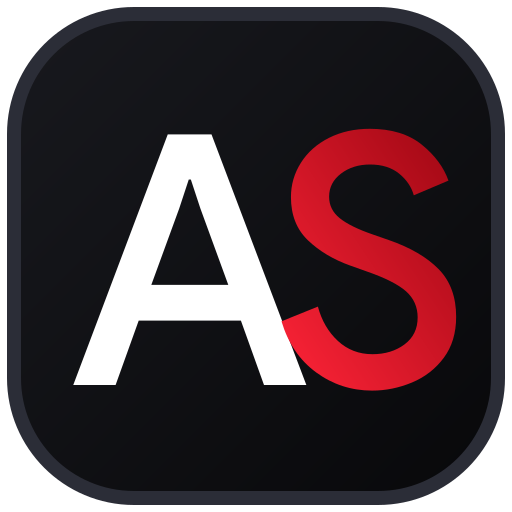

<div align="center">

  

  # Anuj Sharma
  ### Software Development Engineer · Data Science Undergraduate

  [](https://react.dev/)
  [](https://www.typescriptlang.org/)
  [](https://tailwindcss.com/)
  [](https://vitejs.dev/)
  [](https://www.framer.com/motion/)
  [](https://github.com/anujsharma8d)

  <p align="center">
    A minimalist, high-performance developer portfolio and digital resume inspired by editorial design systems and modern web craft.
  </p>

  <p align="center">
    <a href="#-features">Features</a> •
    <a href="#-tech-stack">Tech Stack</a> •
    <a href="#-featured-projects">Featured Projects</a> •
    <a href="#-getting-started">Getting Started</a> •
    <a href="#-project-structure">Project Structure</a> •
    <a href="#-connect">Connect</a>
  </p>

</div>

---

## ⚡ Overview

This repository contains the source code for my personal portfolio and interactive resume. Built with **React 18**, **TypeScript**, **Tailwind CSS v4**, and **Framer Motion**, the application showcases my engineering background, featured systems, open-source milestones, and technical skillset with a focus on fluid interactivity and typography.

---

## ✨ Key Features

- **Editorial 3D Hero Section**: Layered foreground portrait cutout with real-time mouse parallax, multi-stage entrance choreography, and monumental typography.
- **Interactive Spotlight Mask Shader**: Cursor-tracking radial spotlight mask that selectively reveals signature crimson accents across major section titles.
- **Fluid Multi-Device Responsiveness**: Handcrafted responsive breakpoints adapting typography clamps, spacing, and mobile navigation modals cleanly across devices (360px phones to 4K displays).
- **Project Showcase**: Rich cards detailing architecture, live demos, repository links, and tech stacks for production applications and distributed systems.
- **Open-Source Impact Dashboard**: Real-time tracked metrics highlighting **100+ merged pull requests** and active repository maintenance.
- **Custom Vector Branding**: Bespoke Google Sans-derived SVG favicon and high-resolution Apple touch icons with signature obsidian-and-crimson styling.
- **Zero-Compromise Performance**: Sub-second load times powered by Vite's native ES-module pipeline and optimized image assets.

---

## 🛠️ Tech Stack

### Frontend & UI
- **Core Framework**: [React 18](https://react.dev/) + [TypeScript](https://www.typescriptlang.org/)
- **Styling**: [Tailwind CSS v4](https://tailwindcss.com/)
- **Animation**: [Framer Motion](https://www.framer.com/motion/)
- **Build Tooling**: [Vite 6](https://vitejs.dev/)
- **Typography**: Google Sans, League Spartan, Inter, Bebas Neue

### Engineering Capabilities
- **Languages**: TypeScript, JavaScript, Python, C++, SQL
- **Frontend**: React, Next.js, Redux, Tailwind CSS, Framer Motion, WebAssembly (WASM)
- **Backend & APIs**: Node.js, Express.js, REST APIs, GraphQL, Microservices, JWT Auth
- **Data & Storage**: PostgreSQL, MongoDB Atlas, Redis, Prisma ORM
- **DevOps & Cloud**: Docker, Kubernetes, CI/CD Pipelines, Linux, AWS, Git/GitHub
- **Problem Solving**: 600+ Data Structures & Algorithms problems solved across LeetCode & competitive platforms

---

## 🚀 Featured Projects

### 1. [Mockspire](https://github.com/anujsharma8d/mockspire) · [Live Demo](https://mockspire.vercel.app/)
> **Intelligent AI-Powered Interview Simulation Platform**
- Built with **Google Gemini API**, **React 18**, **Node.js**, **Express**, and **MongoDB Atlas**.
- Provides real-time speech-to-text evaluation, dynamic follow-up questioning, and instant competency scoring.
- Actively maintained open-source repository welcoming community contributions and review workflows.

### 2. [Mobile Transformer](https://github.com/anujsharma8d/MobileTransformer)
> **Distributed Transformer Inference Across Mobile Devices**
- Orchestrates distributed large language model inference using browser-based CPUs via **WebAssembly (WASM)** and **Web Workers**.
- Eliminates cloud GPU costs by partitioning transformer layers across a peer-to-peer mobile mesh.

---

## 💻 Getting Started

### Prerequisites
- [Node.js](https://nodejs.org/) (version `18.0.0` or higher recommended)
- `npm`, `pnpm`, or `yarn` package manager

### Installation

1. **Clone the repository:**
   ```bash
   git clone https://github.com/anujsharma8d/portfolio.git
   cd portfolio
   ```

2. **Install dependencies:**
   ```bash
   npm install
   ```

3. **Start the local development server:**
   ```bash
   npm run dev
   ```
   Open [http://localhost:5173](http://localhost:5173) in your browser to view the application with Hot Module Replacement (HMR).

### Building for Production

Compile TypeScript and build the optimized production bundle:
```bash
npm run build
```

Preview the production build locally:
```bash
npm run preview
```

---

## 📁 Project Structure

```
Portfolio/
├── public/
│   ├── favicon.svg             # Custom vector monogram favicon
│   ├── favicon-32x32.png       # 32x32 tab fallback
│   ├── apple-touch-icon.png    # 180x180 iOS touch icon
│   ├── fonts/                  # Self-hosted Google Sans font files
│   └── icons/                  # SVG tech stack & tool icons
├── src/
│   ├── components/
│   │   ├── Navbar.tsx          # Dual-capsule desktop & mobile drawer navigation
│   │   ├── HeroSection.tsx     # 3D interactive hero with cursor spotlight & portrait
│   │   ├── SkillsSection.tsx   # Categorized interactive tech stack grid
│   │   ├── AboutSection.tsx    # Bio, education link, and CTAs
│   │   ├── EducationSection.tsx# NIT Jalandhar degree, coursework & timeline
│   │   ├── ProjectsSection.tsx # Featured production systems & distributed AI
│   │   ├── OpenSourceSection.tsx# Open-source contributions & metric tracking
│   │   ├── FooterSection.tsx   # Monumental Google Sans footer with blur gradient
│   ├── App.tsx                 # Root layout composer
│   ├── main.tsx                # Application entrypoint
│   └── index.css               # Global theme tokens, typography & Tailwind imports
├── index.html                  # HTML template with metadata & favicon links
├── package.json                # Project dependencies & build scripts
├── tsconfig.json               # TypeScript compiler configuration
├── vite.config.ts              # Vite configuration with Tailwind v4 & React plugins
└── README.md                   # Project documentation
```

---

## 📬 Connect

- **GitHub**: [@anujsharma8d](https://github.com/anujsharma8d)
- **LinkedIn**: [linkedin.com/in/anujsharma8d](https://www.linkedin.com/in/anujsharma8d/)
- **LeetCode**: [leetcode.com/u/AnujSharma8d](https://leetcode.com/u/AnujSharma8d/)
- **Email**: [anujsharma8d@gmail.com](mailto:anujsharma8d@gmail.com)

---

<div align="center">
  <small>© 2026 Anuj Sharma · Designed & Developed with Craft</small>
</div>
